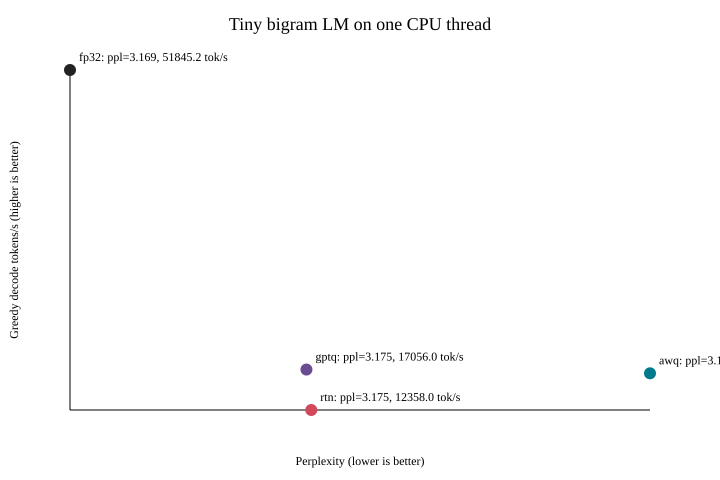

# awq-vs-gptq-int4-marlin-bench

## Context

**Techniques from 2023–2024, reimplemented in 2026.** Era 2: Senior AI Engineer, efficient LLM inference. This repository compares round-to-nearest (RTN), activation-aware AWQ, and Hessian-compensated GPTQ using real packed groupwise INT4 weights, a mixed-precision torch decode path, and the official Marlin FP16xINT4 CUDA kernel.

## Problem

Weight-only INT4 reduces memory traffic, but independent rounding can disproportionately damage channels with large activations or correlated inputs. AWQ protects activation-salient channels by scaling weights before quantization. GPTQ instead quantizes sequentially and updates not-yet-quantized weights to compensate for calibration loss. A useful comparison must execute the packed representation and measure both model quality and decode throughput, not just report fake-quantized weight error.

## Method

For each output row and input group, asymmetric unsigned INT4 uses

```
scale = (max(W_group) - min(W_group)) / 15
zero  = clamp(round(-min(W_group) / scale), 0, 15)
q     = clamp(round(W_group / scale) + zero, 0, 15)
```

Two nibbles are packed into each `uint8`, low nibble first. Odd input widths are padded only in storage. `Int4Linear` unpacks the nibbles, reconstructs `scale * (q - zero)` in fp32, and multiplies fp32 activations by that matrix. This is actual 4-bit persistent storage with an explicit mixed-precision matmul, not a call to a uniform fake-quantization operator. Constant positive and negative groups have dedicated exact encodings.

**AWQ.** For calibration activations `X`, salience is `s_j = mean_i |X_ij|`. Candidates `s_j ** alpha` are normalized to mean one for `alpha ∈ {0, .25, .5, .75, 1}`. The implementation quantizes `W * s`, evaluates `(X / s) @ dequant(W_q).T`, and selects the candidate with the lowest calibration MSE. The inverse input scale is applied at inference. Alpha zero is the RTN candidate.

**GPTQ.** Calibration estimates `H = 2 XᵀX / n + lambda I`. A damped inverse-Cholesky factor drives sequential column quantization. After quantizing column `i`, each remaining column is updated by

```
W[:, i+1:] -= ((W[:, i] - Wq[:, i]) / Hinv[i,i]) * Hinv[i,i+1:]
```

Group scales and zero points come from the original weights; later quantized values include compensation from earlier columns. This is the Hessian-based error-compensation algorithm, implemented directly on small torch matrices.

The end-to-end model is a learned 32-token, 32-hidden bigram LM with an embedding, RMSNorm, a two-layer MLP residual block, and an output head. Its three linear layers are replaced by packed INT4 modules. Calibration captures their real inputs with forward pre-hooks. Evaluation uses next-token cross entropy; throughput uses autoregressive greedy decoding.

## Results

Measured with Python 3.12.3, torch 2.15.0+cpu, one CPU thread, 160 AdamW steps, 128 training and 128 disjoint evaluation sequences of length 33 from the same three-successor Markov process, group size 16, and seven decode repetitions. Decode used batch 16 for 32 tokens per repetition. Training loss fell from 3.57505 to 1.12816. Raw measurements and configuration are committed in `results/tiny_cpu.json`; the plot is `results/tiny_cpu_pareto.svg`.

| method | held-out perplexity | median greedy tok/s | linear storage bytes |
|---|---:|---:|---:|
| fp32 | **3.168666** | **51,845.18** | 20,864 |
| RTN INT4 | 3.175147 | 12,358.04 | 5,056 |
| AWQ INT4 | 3.184247 | 16,620.84 | 5,056 |
| GPTQ INT4 | 3.175018 | 17,055.97 | 5,056 |

The INT4 representations use **75.7669% fewer linear-layer bytes** than fp32, including scales, zero points, biases, and explicit input-scale vectors; embeddings and activations are excluded. GPTQ is best among the INT4 perplexities by a very small margin, while AWQ is worse than RTN here. This single tiny task does not establish a general ranking.

The CPU packed path is **slower** than fp32: unpacking and dequantization dominate these tiny matrix multiplications. These are real throughput numbers, not a claimed Marlin speedup. The non-dominated points in this run are fp32, GPTQ, and AWQ; RTN is narrowly dominated by GPTQ.



## Marlin CUDA benchmark

`src/awq_gptq/marlin_bench.py` is an executable end-to-end benchmark, not a placeholder. It loads a local fp32 `TinyBigramLM` checkpoint, captures calibration activations, constructs real symmetric RTN, AWQ, or GPTQ INT4 weights, and packs every linear layer through the official `marlin.Layer.pack` API. Inference calls `marlin.Layer.forward`, which executes the compiled Marlin FP16xINT4 CUDA kernel. The original packed CPU implementation is independent and unchanged.

Marlin's symmetric representation uses `scale = 2 * max(abs(W_group)) / 15` and signed codes in `[-8, 7]`; Marlin stores those codes with zero point eight. The adapter supports group size 128 or per-channel (`-1`), applies AWQ's inverse input scale inside `MarlinLinear`, and retains biases separately because official Marlin layers have no bias. Official shape restrictions are enforced: input features divisible by 128 and output features divisible by 256.

The benchmark evaluates fp32 and Marlin models on identical held-out sequences and runs the same autoregressive greedy decode with the same batch, token count, and warmups. Every measured repetition is bracketed by `torch.cuda.synchronize`. JSON contains both perplexities, median/min/max tok/s, speedup, quantization time, actual Marlin buffer storage, GPU/library metadata, and the complete configuration. Output is written only after both runs succeed. Missing CUDA, an unsupported GPU, or a missing/broken official Marlin extension exits with status 2 and a clear `PENDING` message; there is no CPU fallback or fabricated result.

**GPU measurements remain pending on this CPU-only host.** The kernel path and CLI are implemented, but actual CUDA execution, kernel numerics, and GPU performance have not been verified here.

### Dependency

The adapter targets **official IST-DASLab Marlin 0.1.1** (`marlin.Layer` and `marlin.mul`), not AutoGPTQ or vLLM. Use an NVIDIA GPU with compute capability >= 8.0, CUDA >= 11.8, an `nvcc` matching the torch CUDA build, and a separate environment:

```bash
python -m venv .venv-marlin && source .venv-marlin/activate
# Install a CUDA-enabled torch build appropriate for the host first.
git clone https://github.com/IST-DASLab/marlin.git
cd marlin
python -m pip install .
cd ..
python -m pip install -e ".[dev]"
```

No transformers, datasets, sentencepiece, or model-download package is used by this benchmark.

### Local checkpoint and token format

The checkpoint is a local `.pt`/`.pth` dictionary loaded with `weights_only=True`:

```python
{
    "format": "awq-gptq-tiny-bigram-v1",
    "config": {"vocab_size": 256, "hidden_size": 256, "expansion": 2},
    "state_dict": TinyBigramLM(256, 256, 2).state_dict(),
}
```

Dimensions may be compatible multiples; the preparation command uses 256/256/2. Tokens are integer `[sequences, sequence_length]` arrays in `.npy`, or `.pt`/`.pth` tensors or `{"tokens": tensor}` dictionaries. IDs must be within the checkpoint vocabulary. The first `--calibration-sequences` sequences calibrate quantization; all remaining sequences are held out for perplexity and decode. NumPy loading uses `allow_pickle=False`.

To train and export a compatible local example without network access:

```bash
PYTHONPATH=src python -m awq_gptq.prepare_marlin_data \
  --checkpoint artifacts/tiny256.pt --dataset artifacts/tokens.pt \
  --steps 160 --train-sequences 128 --calibration-sequences 64 \
  --eval-sequences 128 --sequence-length 33
```

Run the actual Marlin benchmark on the supported CUDA host:

```bash
PYTHONPATH=src python -m awq_gptq.marlin_bench \
  --model-checkpoint artifacts/tiny256.pt --dataset artifacts/tokens.pt \
  --method gptq --group-size 128 --batch-size 16 --decode-tokens 128 \
  --repeats 50 --calibration-sequences 64 --output results/marlin_cuda.json
```

Use `--method awq` or `--method rtn` for the other symmetric Marlin quantizers. `scripts/marlin_benchmark.sh` invokes the same module with `PYTHON_BIN` support.

## Reproduce

CPU implementation and tests:

```bash
python -m venv .venv && source .venv/bin/activate
pip install torch --index-url https://download.pytorch.org/whl/cpu
pip install -e ".[dev]"
ruff check .
pytest -q
scripts/smoke.sh
scripts/benchmark.sh --smoke --output results/smoke.tmp
scripts/benchmark.sh --output results/tiny_cpu.json
```

On this workspace, use `PYTHON_BIN=/home/pus/.venvs/portfolio/bin/python` for the shell scripts. Rerunning overwrites the committed CPU measurements with current timings. The CPU benchmark and tests need no network, dataset download, transformers, Marlin, or GPU.

The 43-test suite covers the original nibble/group/AWQ/GPTQ/model/benchmark checks plus Marlin shape and config validation, strict checkpoint/token loading, symmetric quantization, packing adapters, bias/input scaling, synchronized timing, end-to-end adapter evaluation and JSON output, and pending CLI behavior. Test doubles inject a CPU adapter only in tests; production requires official Marlin and CUDA. Earlier mutation checks replaced independent group scales, disabled AWQ salience, and removed GPTQ's residual update; each made pytest fail, and the restored original suite passed.

## Limitations

- Both CPU and Marlin harnesses use the synthetic `TinyBigramLM`, not a Hugging Face transformer or natural-language corpus. The Marlin checkpoint schema deliberately enforces official kernel-compatible dimensions.
- GPTQ applies full trailing-matrix updates for clarity. Production lazy batch/block updates are more efficient; calibration and packing cost is reported separately from decode tok/s.
- The CPU torch path reconstructs fp32 weights on every invocation. Marlin uses FP16 activations and non-quantized model components, so the end-to-end fp32 comparison includes the intended precision differences rather than isolating only GEMM latency.
- AWQ uses output MSE on captured calibration inputs and a small alpha grid. It does not reproduce every implementation detail of the original AutoAWQ kernels.
- Storage accounting includes actual Marlin weight/scale buffers but excludes workspaces, embeddings, activations, allocator overhead, and RSS.
- Official Marlin CUDA execution and GPU result quality/performance remain untested on this host; no GPU measurements are claimed.

## References

- J. Lin et al. *AWQ: Activation-aware Weight Quantization for LLM Compression and Acceleration.* MLSys 2024. arXiv:2306.00978.
- E. Frantar et al. *GPTQ: Accurate Post-Training Quantization for Generative Pre-trained Transformers.* ICLR 2023. arXiv:2210.17323.
- E. Frantar and D. Alistarh. *SparseGPT: Massive Language Models Can Be Accurately Pruned in One-Shot.* ICML 2023 (related optimal brain compression background). arXiv:2301.00774.
- E. Frantar et al. *MARLIN: Mixed-Precision Auto-Regressive Parallel Inference on Large Language Models.* 2024. arXiv:2408.11743. Kernel: https://github.com/IST-DASLab/marlin.

## License

MIT
